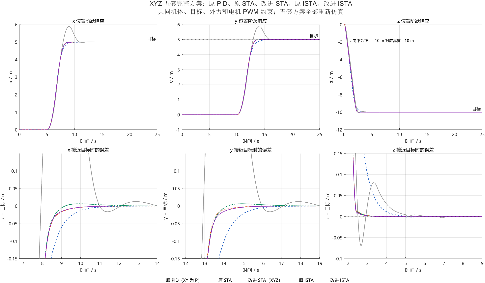

# 四旋翼控制仿真与性能对比

基于 MATLAB / Simulink，对比原 PID（XY 速度环实际为 P）、原 STA、改进 STA、原 ISTA 和改进 ISTA 五套位置控制方案。已在 MATLAB R2022a 中完成 20 次主仿真及 20 次半步长复核。

## 快速运行

安装 MATLAB 和 Simulink，下载或克隆仓库，将 MATLAB 当前文件夹切到仓库根目录，然后运行：

```matlab
compare_controllers             % 重新运行五方案 × 四工况，生成指标和图表
compare_controllers('verify')   % 额外执行半步长复核，共40次仿真
compare_controllers('plot')     % 仅重画图；需要先在本机运行生成 comparison.mat
```

无需手动执行初始化脚本。比较程序使用已保存模型的临时副本，不修改源 SLX。修改控制参数后，请先保存模型再重新运行。

## 文件结构

| 路径 | 内容 |
| --- | --- |
| `PID/` | 原 PID 基线模型及其原有初始化文件 |
| `sta/` | 最早原 STA（非 fixed 版）与 XYZ 改进 STA |
| `ista/` | 原 ISTA 与改进 ISTA |
| `compare_controllers.m` | 仿真入口、统一工况、指标计算 |
| `plot_controller_comparison.m` | 生成 11 组 PNG / PDF 图 |
| `write_controller_report.m` | 生成报告、指标表和 CSV |
| `results/` | 已运行的对比结果；再次运行会更新 |

## 对比内容

- XYZ 阶跃响应、接近目标误差、扰动偏差和尾段波动。
- 超调率、上升时间、调节时间、RMSE、IAE、扰动峰值及恢复时间。
- 公共油门、水平加速度指令、PWM 限幅情况及 yaw 跟踪。

每次仿真 42 s；目标为 x = 5 m、y = 5 m、z = −10 m、yaw = 5°。分别测试无扰动和 XYZ 单轴外力：30–32 s 施加 0.7 N。五组统一机体参数与电机 PWM 1000–2000 约束，保留各自控制增益、前馈及内部限幅；这是当前完整方案的比较。z 向下为正，z = −10 m 对应向上高度 10 m。

原 ISTA 的部分指标对求解步长较敏感，复核结果见报告。公共油门是四电机共用的基础油门；油门总变差表示指令变化程度，不等于能耗。yaw 图未单独测试偏航外力矩扰动。

## 查看结果

- [五种控制方案的具体改进与原因](控制方案改进说明.md)
- [性能对比报告](results/性能对比报告.md)
- [XYZ 指标表](results/XYZ指标表.md)
- [XYZ 指标 CSV](results/data/xyz_metrics.csv) / [yaw 指标 CSV](results/data/yaw_metrics.csv)
- [详细使用说明](使用说明.md)



仓库保留报告、CSV 和 PNG/PDF 图。完整时序 `results/data/comparison.mat`、含本机路径的 JSON 运行记录和 Simulink 缓存由运行生成，不纳入 Git。
