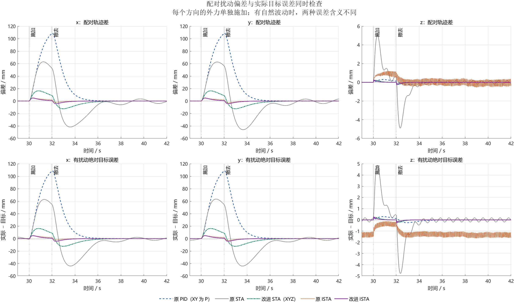
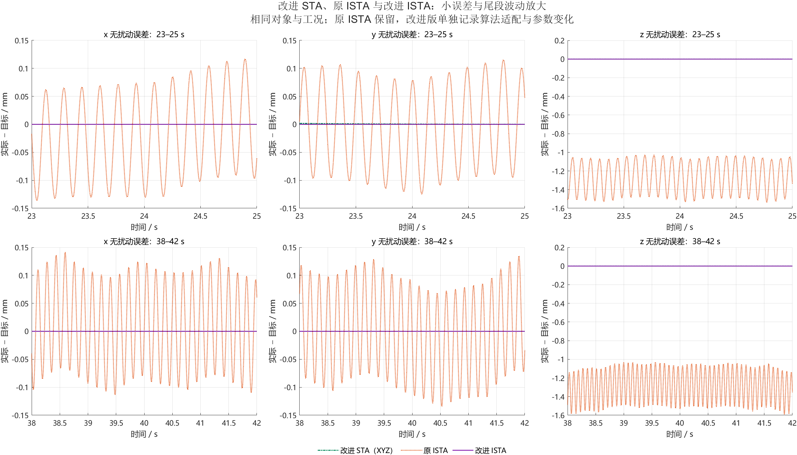
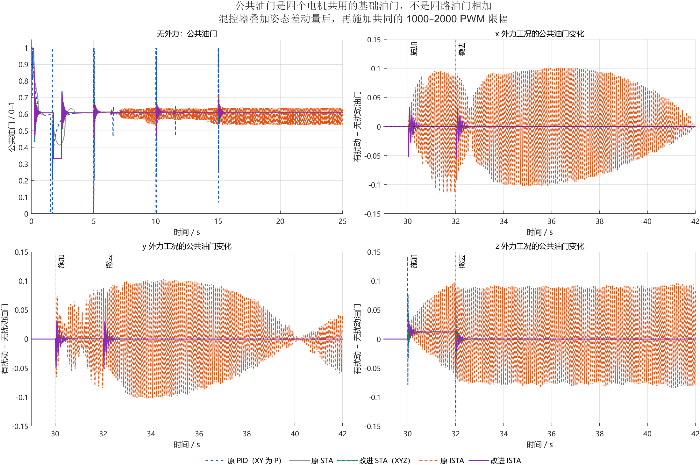
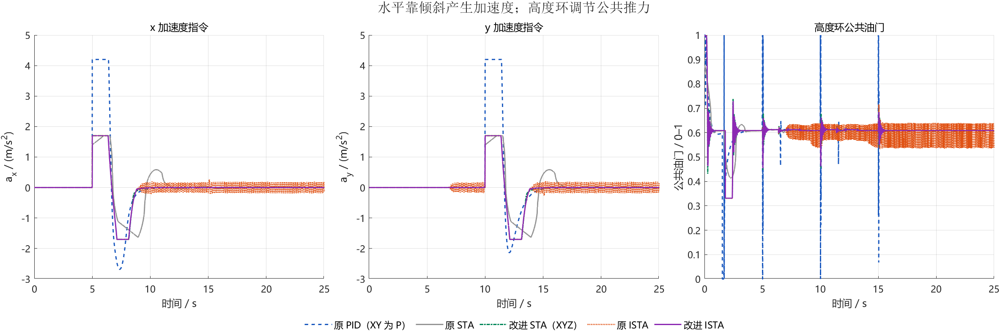
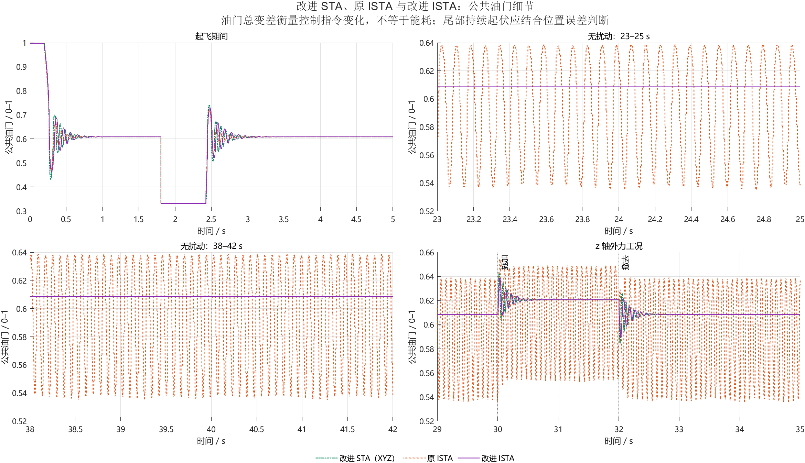
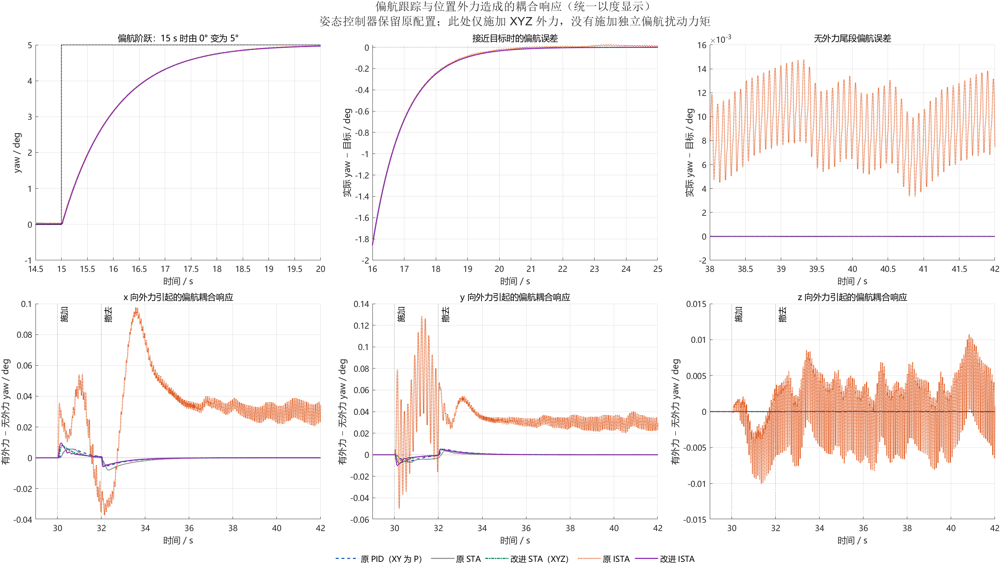

# 五套四旋翼控制方案的性能对比

本报告由同目录比较代码根据本次保存的实际仿真结果生成。比较的是各模型当前参数下的完整控制方案；并不意味着每种算法均已充分整定到各自最优。判断性能时同时查看超调、收敛、抗扰偏差、尾段误差和控制指令波动，不能只用某一项最小值宣称全面优越。

## 1 对比对象与统一工况

| 方案 | 模型 |
| --- | --- |
| 原 PID（XY 为 P） | `drone_position_control.slx` |
| 原 STA（最早未修正版） | `drone_position_control_sta_function.slx` |
| 改进 STA（XYZ） | `drone_position_control_sta_z_tuned.slx` |
| 原 ISTA | `drone_position_control_ista.slx` |
| 改进 ISTA | `drone_position_control_ista_tuned.slx` |

“原 PID”是原模型名称，XY 速度控制实际上只有 P；“原 STA”指最早的 `sta_function`，不是 `fixed` 边界层修正版。改进 STA 与改进 ISTA 分别使用已保存的 XYZ 改进方案。姿态控制环保持模型中的公共基线，因此本次位置通道对比不等于同时重新设计了姿态环。

| 项目 | 本次设置 |
| --- | --- |
| x 目标 | 5 s：0 → 5 m |
| y 目标 | 10 s：0 → 5 m |
| z 目标 | 0 s：0 → -10 m；惯性系 z 向下为正 |
| yaw 目标 | 15 s：0 → 5°；统计和图中统一换算为度 |
| 仿真时间 | 0–42 s |
| 外力 | 30–32 s，惯性系对应轴正方向 0.7 N |
| 场景 | 无扰动；仅 x 外力；仅 y 外力；仅 z 外力，三个方向分别测试 |
| 四路电机 PWM 限幅 | 所有方案相同，1000–2000 |
| 主试验机体求解步长 | 0.0005 s |
| 减半步长设置 | 0.00025 s；实际是否执行见第 6 节 |
| 离散 STA/ISTA 采样周期 | 0.005 s；原 PID 的连续设置保留 |
| 共同质量 | 1.4 kg |
| 机体求解器 | ode4 |

比较代码统一目标、机体参数、扰动和电机输出边界；各方案内部的控制结构与参数保留。因此横向差异可能同时来自算法、增益和前馈/抗饱和适配。原PID和最早原STA保留水平速度误差的±1限幅，另外三组保留不限幅设置；最终电机PWM约束则对五组一致。这里测试的是简化模型；表格中的毫米级数值不能直接解释为实机可实现的定位精度。

## 2 XYZ 阶跃和扰动响应

| 轴 | 方案 | 超调率 / % | 10–90%上升时间 / s | 2%调节时间 / s | 23–25 s最大误差 / mm | 配对扰动峰值 / mm | 恢复时间 / s |
| --- | --- | ---: | ---: | ---: | ---: | ---: | ---: |
| x | 原 PID（XY 为 P） | 0.0000 | 1.9981 | 3.6995 | <0.001 | 108.694 | 1.9975 |
| x | 原 STA（最早未修正版） | 17.9904 | 1.7876 | 5.5510 | 2.414 | 62.853 | 3.7405 |
| x | 改进 STA（XYZ） | 0.1300 | 1.9370 | 3.2465 | <0.001 | 16.254 | 1.5785 |
| x | 原 ISTA | 0.0031 | 1.9413 | 3.2665 | 0.136 | 5.008 | 0.0000 |
| x | 改进 ISTA | 0.0000 | 1.9404 | 3.2610 | <0.001 | 4.730 | 0.0000 |
| y | 原 PID（XY 为 P） | 0.0000 | 2.1250 | 4.0035 | <0.001 | 108.693 | 1.9975 |
| y | 原 STA（最早未修正版） | 17.9993 | 1.7870 | 5.5495 | 2.821 | 62.544 | 3.5085 |
| y | 改进 STA（XYZ） | 0.1300 | 1.9371 | 3.2465 | 0.002 | 16.254 | 1.5785 |
| y | 原 ISTA | 0.0023 | 1.9346 | 3.2360 | 0.124 | 5.111 | 0.0000 |
| y | 改进 ISTA | 0.0000 | 1.9405 | 3.2610 | <0.001 | 4.733 | 0.0000 |
| z | 原 PID（XY 为 P） | 0.0163 | 1.5992 | 2.6985 | <0.001 | 0.294 | 2.1385 |
| z | 原 STA（最早未修正版） | 0.6910 | 1.6372 | 2.3665 | 0.185 | 5.031 | 未恢复 |
| z | 改进 STA（XYZ） | 0.0142 | 1.6133 | 2.2290 | <0.001 | 0.227 | 0.6350 |
| z | 原 ISTA | 0.0231 | 1.6134 | 2.2295 | 1.534 | 1.196 | 未恢复 |
| z | 改进 ISTA | 0.0148 | 1.6132 | 2.2275 | <0.001 | 0.289 | 0.3610 |

- 超调率先按目标方向统一符号，再以阶跃幅值归一化，因此 z 的负目标不会导致符号误判。10–90%上升时间取响应首次跨越两个阈值的时间差。
- 2%调节时间从各轴阶跃时刻起算：x/y 的误差带为 ±0.1/±0.1 m，z 为 ±0.2 m，要求进入后直到 25 s 不再越界。“未调节”表示观察窗口内未满足条件。
- 23–25 s最大误差只描述该窗口，不能代表之后已收敛。无扰尾段统计使用 38–42 s，RMS 为误差平方的时间平均值再开方，峰峰值为窗口最大值减最小值。
- 配对扰动误差 = 同一方案有扰动位置 − 无扰动位置；峰值及 IAE 使用 30–42 s。有扰绝对误差 = 有扰动位置 − 目标位置。
- 恢复时间从 32 s 撤去外力后起算，x/y/z 误差带分别为 ±10、±10、±0.1 mm；入带后需保持到 42 s，且至少有 1 s 带内记录。“未恢复”表示未满足该标准；0 表示撤去外力时已在带内且随后保持，并不表示误差瞬间归零。不同轴的恢复阈值不同，不能直接跨轴排名。
- 阶跃窗口为各轴阶跃时刻至 25 s。RMSE 衡量整体误差幅度，IAE 是绝对误差的时间积分；二者都包含跟踪目标的过渡过程。
- 表格中小于 0.001 mm 的非负误差显示为“<0.001”，并非数学上等于零。CSV 保留完整数值；NaN 表示观察窗口内指标未满足或不可定义。

分别查看：[x通道](figures/01_x通道对比.png)、[y通道](figures/02_y通道对比.png)、[z通道](figures/03_z通道对比.png)。

## 3 小误差、尾段波动与整体误差

| 轴 | 方案 | 无扰尾段RMS / mm | 无扰尾段峰峰值 / mm | 无扰尾段最大绝对误差 / mm | 有扰绝对误差峰值 / mm | 有扰绝对误差RMS / mm |
| --- | --- | ---: | ---: | ---: | ---: | ---: |
| x | 原 PID（XY 为 P） | <0.001 | <0.001 | <0.001 | 108.694 | 38.942 |
| x | 原 STA（最早未修正版） | 1.716 | 4.549 | 2.275 | 62.788 | 27.256 |
| x | 改进 STA（XYZ） | <0.001 | <0.001 | <0.001 | 16.254 | 6.733 |
| x | 原 ISTA | 0.074 | 0.254 | 0.141 | 4.951 | 1.385 |
| x | 改进 ISTA | <0.001 | <0.001 | <0.001 | 4.730 | 1.480 |
| y | 原 PID（XY 为 P） | <0.001 | <0.001 | <0.001 | 108.693 | 38.942 |
| y | 原 STA（最早未修正版） | 1.672 | 4.565 | 2.285 | 63.366 | 27.556 |
| y | 改进 STA（XYZ） | <0.001 | <0.001 | <0.001 | 16.254 | 6.733 |
| y | 原 ISTA | 0.073 | 0.269 | 0.135 | 5.019 | 1.479 |
| y | 改进 ISTA | <0.001 | <0.001 | <0.001 | 4.733 | 1.480 |
| z | 原 PID（XY 为 P） | <0.001 | <0.001 | <0.001 | 0.294 | 0.119 |
| z | 原 STA（最早未修正版） | 0.132 | 0.370 | 0.185 | 4.856 | 1.387 |
| z | 改进 STA（XYZ） | <0.001 | <0.001 | <0.001 | 0.227 | 0.058 |
| z | 原 ISTA | 1.294 | 0.556 | 1.587 | 1.637 | 1.201 |
| z | 改进 ISTA | <0.001 | <0.001 | <0.001 | 0.289 | 0.043 |

| 轴 | 方案 | 阶跃窗口RMSE / m | 阶跃窗口IAE / (m·s) | 配对扰动IAE / (m·s) |
| --- | --- | ---: | ---: | ---: |
| x | 原 PID（XY 为 P） | 1.302470 | 9.009615 | 0.237854 |
| x | 原 STA（最早未修正版） | 1.347543 | 10.454835 | 0.220453 |
| x | 改进 STA（XYZ） | 1.304133 | 8.888483 | 0.050537 |
| x | 原 ISTA | 1.304539 | 8.901333 | 0.008537 |
| x | 改进 ISTA | 1.304210 | 8.893360 | 0.009006 |
| y | 原 PID（XY 为 P） | 1.506281 | 9.166480 | 0.237854 |
| y | 原 STA（最早未修正版） | 1.554987 | 10.437631 | 0.224334 |
| y | 改进 STA（XYZ） | 1.505781 | 8.887715 | 0.050538 |
| y | 原 ISTA | 1.504220 | 8.864058 | 0.009814 |
| y | 改进 ISTA | 1.505873 | 8.892623 | 0.009008 |
| z | 原 PID（XY 为 P） | 1.773039 | 11.439898 | 0.000847 |
| z | 原 STA（最早未修正版） | 1.892293 | 12.538190 | 0.008293 |
| z | 改进 STA（XYZ） | 1.789393 | 11.433853 | 0.000277 |
| z | 原 ISTA | 1.789611 | 11.453729 | 0.004036 |
| z | 改进 ISTA | 1.788863 | 11.426762 | 0.000175 |

配对扰动轨迹差可以隔离原有跟踪过程，但如果控制器本身存在持续振荡，外力可能改变其相位，此时“有扰动减无扰动”还包含自然波动的相位差，不能单独作为抗扰能力的定论。需要同时看有扰时的绝对目标误差，以及无扰时的尾段 RMS、峰峰值和偏置。同样，进入较宽的 2%误差带并不意味着微小振荡已经消失。

## 4 公共油门与控制动作

公共油门是四个电机共用的基础油门指令，归一化后通常在 0–1 之间。混控器在它的基础上叠加姿态控制所需的差动量，得到四路电机指令，再经过统一 PWM 限幅。**它不是四路油门相加，也不是单位为 N 的总推力。** 悬停时即使位置误差为零，也仍需非零公共油门抵消重力。其时变曲线可检查高度环如何增减推力，以及倾斜时如何补偿竖直推力损失。

公共油门总变差 TV = 相邻记录值变化量绝对值的总和。它反映指令变化和波动程度，**不是能耗**，也不等于真实电机损耗；TV 应在相同采样、记录频率和时间窗口下比较。实际能耗需要电压、电流或电机功率模型。最终四路电机指令还受到姿态混控影响，因此这里同时报告原始 PWM 超出共同边界的时间比例。

| 方案 | 公共油门TV 0–25 s | 公共油门TV 38–42 s | 无扰尾段油门峰峰值 | 原始PWM越界时间比例 0–25 s / % |
| --- | ---: | ---: | ---: | ---: |
| 原 PID（XY 为 P） | 23.82724 | 0.00000 | 0.000000 | 0.7120 |
| 原 STA（最早未修正版） | 1.03110 | 0.00667 | 0.000630 | 0.4180 |
| 改进 STA（XYZ） | 6.60656 | 0.00000 | 0.000000 | 0.3780 |
| 原 ISTA | 42.21477 | 9.96254 | 0.103752 | 4.5619 |
| 改进 ISTA | 5.16066 | 0.00000 | 0.000000 | 0.3800 |

这张表的公共油门指标是全机共用量，只报告一次，不能把 XYZ 三行中的相同值相加。“原始PWM越界时间比例”统计限幅前至少一个电机超出上下界的记录时刻比例；它不表示限幅后的执行指令违反约束。

## 5 偏航响应

yaw 是实际偏航角，角度统一换算为度后与 5°目标比较；这里统计无外力工况的偏航阶跃响应，不等于测试了偏航外力矩抗扰。各方案共用姿态环，所以此表也用于检查位置控制改动后是否影响姿态响应。

| 方案 | 超调率 / % | 10–90%上升时间 / s | 2%调节时间 / s | 无扰尾段RMS / ° | 无扰尾段峰峰值 / ° |
| --- | ---: | ---: | ---: | ---: | ---: |
| 原 PID（XY 为 P） | 0.0000 | 2.1929 | 3.9140 | 0.000000 | 0.000000 |
| 原 STA（最早未修正版） | 0.0000 | 2.1891 | 3.9085 | 0.000021 | 0.000022 |
| 改进 STA（XYZ） | 0.0000 | 2.1929 | 3.9165 | 0.000000 | 0.000000 |
| 原 ISTA | 0.4527 | 2.1902 | 3.8310 | 0.009647 | 0.011430 |
| 改进 ISTA | 0.0000 | 2.1929 | 3.9165 | 0.000000 | 0.000000 |

调节时间从 15 s 阶跃起算，误差带为 ±0.1°，持续性检查至 25 s。尾段使用 38–42 s；显示为0.000000仅表示当前小数位分辨率下很小，完整值见CSV。

## 6 求解步长复核

控制器采样周期保持 0.005 s，机体求解步长由 0.0005 s 减半到 0.00025 s。下表只列实际保存在结果中的场景检查；轨迹差指细步长轨迹与主步长轨迹插值后的最大绝对差。

| 方案 | 场景 | x最大差 / mm | y最大差 / mm | z最大差 / mm |
| --- | --- | ---: | ---: | ---: |
| 原 PID（XY 为 P） | 无扰动 | 0.118 | 0.116 | 0.069 |
| 原 PID（XY 为 P） | 仅x外力 | 0.118 | 0.116 | 0.069 |
| 原 PID（XY 为 P） | 仅y外力 | 0.118 | 0.116 | 0.069 |
| 原 PID（XY 为 P） | 仅z外力 | 0.118 | 0.116 | 0.069 |
| 原 STA（最早未修正版） | 无扰动 | <0.001 | <0.001 | 0.001 |
| 原 STA（最早未修正版） | 仅x外力 | 0.005 | <0.001 | 0.001 |
| 原 STA（最早未修正版） | 仅y外力 | <0.001 | 0.005 | 0.001 |
| 原 STA（最早未修正版） | 仅z外力 | <0.001 | <0.001 | 0.001 |
| 改进 STA（XYZ） | 无扰动 | <0.001 | <0.001 | 0.001 |
| 改进 STA（XYZ） | 仅x外力 | 0.002 | <0.001 | 0.001 |
| 改进 STA（XYZ） | 仅y外力 | <0.001 | 0.002 | 0.001 |
| 改进 STA（XYZ） | 仅z外力 | <0.001 | <0.001 | 0.001 |
| 原 ISTA | 无扰动 | 0.311 | 2.894 | 2.364 |
| 原 ISTA | 仅x外力 | 1.673 | 2.894 | 2.364 |
| 原 ISTA | 仅y外力 | 0.311 | 2.894 | 2.364 |
| 原 ISTA | 仅z外力 | 0.311 | 2.894 | 2.364 |
| 改进 ISTA | 无扰动 | <0.001 | <0.001 | 0.001 |
| 改进 ISTA | 仅x外力 | 0.001 | <0.001 | 0.001 |
| 改进 ISTA | 仅y外力 | <0.001 | 0.001 | 0.001 |
| 改进 ISTA | 仅z外力 | <0.001 | <0.001 | 0.001 |

| 轴 | 方案 | 主步长扰动峰值 / mm | 半步长扰动峰值 / mm | 主步长尾段RMS / mm | 半步长尾段RMS / mm |
| --- | --- | ---: | ---: | ---: | ---: |
| x | 原 PID（XY 为 P） | 108.694 | 108.694 | <0.001 | <0.001 |
| y | 原 PID（XY 为 P） | 108.693 | 108.693 | <0.001 | <0.001 |
| z | 原 PID（XY 为 P） | 0.294 | 0.294 | <0.001 | <0.001 |
| x | 原 STA（最早未修正版） | 62.853 | 62.853 | 1.716 | 1.716 |
| y | 原 STA（最早未修正版） | 62.544 | 62.544 | 1.672 | 1.672 |
| z | 原 STA（最早未修正版） | 5.031 | 5.031 | 0.132 | 0.132 |
| x | 改进 STA（XYZ） | 16.254 | 16.254 | <0.001 | <0.001 |
| y | 改进 STA（XYZ） | 16.254 | 16.254 | <0.001 | <0.001 |
| z | 改进 STA（XYZ） | 0.227 | 0.227 | <0.001 | <0.001 |
| x | 原 ISTA | 5.008 | 5.996 | 0.074 | 0.073 |
| y | 原 ISTA | 5.111 | 3.821 | 0.073 | 0.073 |
| z | 原 ISTA | 1.196 | 1.354 | 1.294 | 1.275 |
| x | 改进 ISTA | 4.730 | 4.731 | <0.001 | <0.001 |
| y | 改进 ISTA | 4.733 | 4.733 | <0.001 | <0.001 |
| z | 改进 ISTA | 0.289 | 0.289 | <0.001 | <0.001 |

若不同步长下存在明显幅值或相位变化，尤其持续振荡的配对扰动指标变化明显时，不能把小数末位差异用于性能排名。减半步长检验只反映数值一致性，不等于已经证明算法稳定或实机鲁棒。主图统一展示主步长结果，复核结果用于判断可信范围。

## 7 文件与阅读顺序

在 `matlab_simulation` 文件夹运行 `compare_controllers` 可重新执行五组各四种主工况；`compare_controllers('verify')` 进一步执行半步长复核；`compare_controllers('plot')` 使用本次保存的数据重新绘图和生成报告。主工况和复核均读取当前文件夹中的模型，原始模型文件保持不变。

先看 [XYZ阶跃与接近误差](figures/00_XYZ阶跃与误差总览.png)，再看 [指标汇总图](figures/06_XYZ指标汇总表.png) 与各轴扰动/尾段图，最后检查油门是否持续波动。

- [XYZ指标表](XYZ指标表.md)：可直接复制的表格和指标定义。
- [XYZ完整指标CSV](data/xyz_metrics.csv)：ASCII字段名、中文方案名、UTF-8 BOM，可导入Excel。
- `data/comparison.mat`：本次时域曲线及配置，供重新绘图和进一步分析。
- `data/metrics.json`：机器可读的配置与指标。
- [yaw指标CSV](data/yaw_metrics.csv)：单位为度及其派生量。

各方案可能在不同指标上各有优势。本报告保留所有方案与所有指定工况，不根据结果删掉不利曲线；未观察到的鲁棒性、噪声、执行器故障和实机工况不在此次结论范围内。
