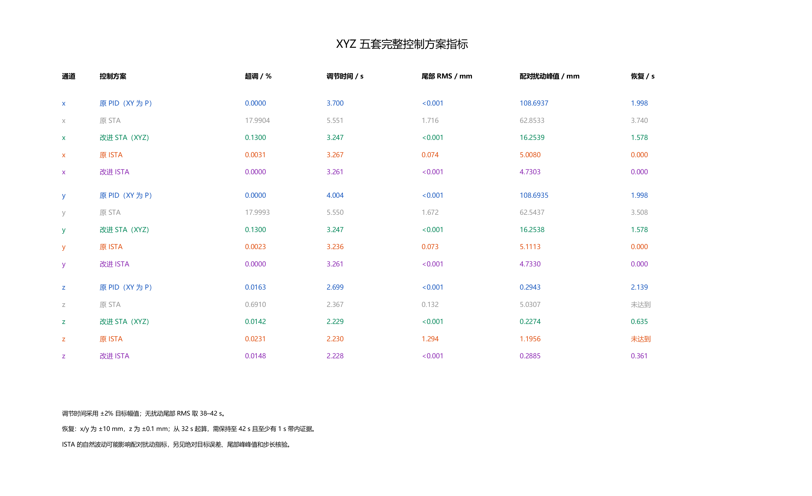

# 五种四旋翼控制方案的改进与性能说明

这五个模型比较的是五套已经搭建、保存并整定的控制方案。**原 STA 的主要不足是 XY 超调较大、高度抗扰和尾段精度较差；原 ISTA 的 XY 抗扰已经明显优于 P 基线，主要不足在高度残余误差和控制指令持续波动。** 因此，准确的结论是“原始实现的部分指标不如当前 PID 配置”，而不是“STA 或 ISTA 算法天然不如 PID”。

本文按“模型关系 → 具体修改 → 修改原因 → 实际结果”说明。参数与控制律对应本仓库 SLX 内嵌函数；数值表取自当前保存的 [XYZ 指标 CSV](results/data/xyz_metrics.csv)。

## 1 五个模型分别是什么

| 方案 | 模型文件 | 控制方式与主要区别 |
| --- | --- | --- |
| 原 PID，XY 为 P | [drone_position_control.slx](PID/drone_position_control.slx) | XY 采用位置 P 与速度 P 串级，速度 P 输出加速度指令；高度采用位置 P 与速度 PID 串级，速度 PID 输出经油门接口作用于飞机。姿态环保留 PID。 |
| 原 STA，最早未修正版 | [drone_position_control_sta_function.slx](sta/drone_position_control_sta_function.slx) | 将 XYZ 速度控制环换成离散 STA；使用平方根项、`sat` 边界层、回算抗饱和和显式积分。XY 没有目标速度导数前馈，高度直接输出油门修正。 |
| 改进 STA，XYZ 均改进 | [drone_position_control_sta_z_tuned.slx](sta/drone_position_control_sta_z_tuned.slx) | XY 加入目标速度变化前馈、层内线性反馈、条件积分并重新整定；Z 改成“加速度 → 总推力 → 公共油门”的控制接口，并考虑重力、倾斜和推力范围。文件名虽有 `z_tuned`，也包含之前的 XY 改进。 |
| 原 ISTA | [drone_position_control_ista.slx](ista/drone_position_control_ista.slx) | 继承改进 STA 的前馈、推力换算和约束，将 XYZ 的 STA 核换成用户提供的作者隐式函数；初始采用与改进 STA 相同的数值增益。 |
| 改进 ISTA | [drone_position_control_ista_tuned.slx](ista/drone_position_control_ista_tuned.slx) | 在原 ISTA 上加入边界层隐式解、积分状态参与的预测补偿，并重新整定参数，重点改善小误差波动和高度偏差。 |

第一行中的串级关系可以直接记成：**位置 P → 目标速度 → 速度 P 或 PID → 加速度或油门指令**。“XY 为 P”只描述水平通道，不能把整架飞机称为只有 P 控制。

五个模型的姿态控制器均保留相同配置。roll、pitch 姿态外环增益为 30，yaw 外环增益为 1；roll、pitch 角速度 PID 为 $(0.3,1.4,0.01)$，yaw 为 $(20,0,0.1)$。本次没有把 yaw 控制器单独换成 STA 或 ISTA。

## 2 先认清控制变量和误差

以下先以 x 轴为例。位置目标保持不变、目标速度未触及限幅时：

$$
e_p=x_d-x,\qquad v_d=\lambda e_p,\qquad s=v_d-v_x.
$$

| 符号 | 含义 |
| --- | --- |
| $e_p$ | 位置误差，单位 m |
| $v_x$ | 飞机实际速度，单位 m/s |
| $s$ | 目标速度减实际速度，单位 m/s；速度控制器中常写成 `e` |
| $\lambda$ | 位置外环比例增益，单位 $\mathrm{s^{-1}}$ |
| $\nu$ | 控制器内部积分状态；加速度控制器中单位为 $\mathrm{m/s^2}$，原高度 STA 中则是油门修正量 |
| $T_s$ | 控制器采样周期，本项目 STA/ISTA 均为 0.005 s |
| $\varepsilon$ | 速度误差边界层宽度，单位 m/s |

**速度误差可以作为本系统的滑模变量。** 因为位置目标固定时 $\dot e_p=-v_x$，所以：

$$
s=\lambda e_p-v_x=\dot e_p+\lambda e_p.
$$

这与常见的“误差导数加误差”的滑模面形式一致。代码把输入命名为 `e`，并不自动意味着它不能作为滑模变量。原模型在某些通道又将该变量裁剪，实际输入和完整 $s$ 的区别将在后面说明。

本文将积分状态统一写为 $\nu$；部分 STA 函数把它命名为 `v`，它不是飞机实际速度。图中的 `1/z` 保存当前状态，接收本次算出的下一步状态，在下一个采样时刻再送回控制函数。

## 3 为什么这个 PID 基线并不弱

原模型的 XY 位置增益为 $\lambda=1$，速度增益为 $K_v=4.2$，速度环的 I 和 D 都为 0。速度误差先限制到 $\pm1\ \mathrm{m/s}$，随后产生加速度指令。

在未限幅、理想加速度跟随的局部近似中：

$$
a_x=K_v\bigl[\lambda(x_d-x)-v_x\bigr].
$$

固定目标下，可以得到位置误差方程：

$$
\ddot e_p+K_v\dot e_p+K_v\lambda e_p=0.
$$

这已经有一个与速度有关的阻尼项 $K_v\dot e_p$。代入当前参数，名义二阶系统的阻尼比为：

$$
\zeta=\frac{K_v}{2\sqrt{K_v\lambda}}
=\frac{\sqrt{4.2}}{2}\approx1.025.
$$

这解释了为什么两个 P 环串起来，也能形成较平稳的位置响应。真实模型还有姿态、电机滞后和限幅，以上计算用于理解局部机制，不能代替完整仿真。

高度基线更不是只有 P：位置增益为 2，目标竖直速度限制为 $\pm5\ \mathrm{m/s}$；速度 PID 的参数为 $K_p=10.7,K_i=12.06,K_d=1.89$，微分滤波系数 $N=100$。它已有积分和微分调节，再围绕 0.60899 的悬停基准换算公共油门。

因此，一个新控制器要超过当前基线，需要匹配完整飞机的响应速度和接口，不能只把控制块替换后就期待所有指标更好。

## 4 原 STA 到改进 STA 改了什么

### 4.1 原 STA 的实际控制律

定义 $\operatorname{clip}(q,l,h)=\min(\max(q,l),h)$，$\operatorname{sat}(q)=\operatorname{clip}(q,-1,1)$。

原 XY 速度误差先裁剪为 $\bar s=\operatorname{clip}(s,-1,1)$，再进入 STA：

$$
\begin{aligned}
\rho_k&=\operatorname{sat}(\bar s_k/\varepsilon),\\
u_{{\rm raw},k}&=k_1\sqrt{|\bar s_k|}\,\rho_k+\nu_k,\\
u_k&=\operatorname{clip}(u_{{\rm raw},k},u_{\min},u_{\max}),\\
\nu_{k+1}&=\operatorname{clip}\!\left(
\nu_k+T_s[k_2\rho_k+k_{\rm aw}(u_k-u_{{\rm raw},k})],
-\nu_{\max},\nu_{\max}\right).
\end{aligned}
$$

原 XY 的 $u$ 是加速度指令。最后一行同时包含前向欧拉积分、回算抗饱和和积分状态限幅。因此，**原 STA 并不是完全没有抗饱和，也不是直接使用未平滑的 `sign`。**

原高度 STA 使用相同形式，但输入为竖直速度误差，输出 $u_z$ 是油门修正：

$$
v_{z,d}=\operatorname{clip}(2(z_d-z),-5,5),\qquad
\sigma_c=\operatorname{clip}(0.60899-u_z,0,1).
$$

这里 z 向下为正。想增加向下速度时，正的 $u_z$ 会减少油门，这个减号与坐标方向一致。$\sigma_c$ 是四电机共用的基础油门，不是四路油门之和。

### 4.2 水平通道的修改

| 项目 | 原 STA | 改进 STA | 作用 |
| --- | --- | --- | --- |
| 位置增益 $\lambda$ | 1 | 1.5 | 调整位置到目标速度的响应 |
| $k_1,k_2$ | 1.4、0.3 | 3、1 | 重新匹配非线性反馈与积分响应 |
| 输入速度误差 | 先限制到 $\pm1$ | 保留完整误差 | 不再将不同的大误差压成同一数值 |
| 目标速度导数前馈 | 无 | $-\lambda v_x$ | 补偿位置外环目标速度的变化 |
| 边界层内非线性项 | $s\sqrt{|s|}/\varepsilon$ | $s/\sqrt\varepsilon$ | 使小误差区具有非零线性反馈增益 |
| 抗饱和 | 回算 | 条件积分 | 输出饱和且积分加重饱和时暂停积分 |
| 保持项 | $\varepsilon=0.1$，$T_s=0.005$ | 相同 | 输出与积分状态均仍限于 $\pm1.7\ \mathrm{m/s^2}$ |

改进后的水平加速度为：

$$
\boxed{
a_{x,d}^{\rm raw}=
\underbrace{-\lambda v_x}_{\text{目标速度变化前馈}}
+\underbrace{k_1\Psi_\varepsilon(s_x)+\nu}_{\text{STA调节}}
},
$$

其中：

$$
\Psi_\varepsilon(s)=
\sqrt{\max(|s|,\varepsilon)}\operatorname{sat}(s/\varepsilon)
=\begin{cases}
s/\sqrt\varepsilon,&|s|\le\varepsilon,\\
\sqrt{|s|}\operatorname{sign}(s),&|s|>\varepsilon.
\end{cases}
$$

**前馈为什么有用：** 固定位置目标时 $\dot v_d=-\lambda v_x$，飞机接近目标时，位置环要求的速度本来就会下降。在理想加速度跟随下：

$$
\dot s=\dot v_d-a_x=-\lambda v_x-a_x.
$$

令 $a_x=-\lambda v_x+u_{\rm STA}$，就得到 $\dot s=-u_{\rm STA}$。通俗地说，前馈预先告诉速度环“目标速度正在降低”，减轻它追赶变化目标的负担。它适用于两个位置阶跃之间的恒定目标；连续轨迹需要相应的正确参考导数。

**边界层到底改了什么：** 原模型早已使用 `sat`。在原点附近，原项 $s\sqrt{|s|}/\varepsilon$ 的斜率趋于 0；改进项的层内斜率为 $1/\sqrt\varepsilon$。因此，这里的修改是重塑小误差反馈，不能把原实现的问题说成“原点斜率无穷大”。

**条件积分怎么做：** 若未限幅的加速度 $a_{\rm raw}$ 超过上限且 $k_2\rho>0$，或者低于下限且 $k_2\rho<0$，该步积分增量置零；反向、能够帮助退出饱和的积分仍允许。随后再限制积分状态幅值。它改变了饱和时的处理方式，并不意味着在任何对象上都必然优于回算。

### 4.3 高度通道的修改

高度的主要变化是**从直接调油门，改为先求目标加速度，再根据模型换算油门**。

$$
v_{z,d}^{\rm raw}=3(z_d-z),\qquad
v_{z,d}=\operatorname{clip}(v_{z,d}^{\rm raw},-5,5),\qquad
s_z=v_{z,d}-v_z.
$$

目标速度未限幅时，它会随位置误差变化；已经限幅时，它保持为常数。因此前馈分两种情况：

$$
a_{\rm ff}=\begin{cases}
-3v_z,&|v_{z,d}^{\rm raw}|<5,\\
0,&|v_{z,d}^{\rm raw}|\ge5.
\end{cases}
\qquad
a_{z,d}^{\rm raw}=a_{\rm ff}+20\Psi_{0.01}(s_z)+\nu.
$$

加速度指令先受到设计范围 $[-22,8]\ \mathrm{m/s^2}$ 与可用推力的共同约束，再换算为推力和油门。令：

$$
c=\operatorname{clip}(\cos\phi\cos\theta,0.2,1),\qquad
T_{\max}=4k_f(C_R+\Omega_0)^2.
$$

代码实际采用的加速度边界为：

$$
a_{\min}^{\rm act}=\max(-22,g-T_{\max}c/m),\qquad
a_{\max}^{\rm act}=\min(8,g).
$$

由已经学过的竖直动力学 $a_z=g-T\cos\phi\cos\theta/m$，得到：

$$
\boxed{
T_d=\max\left(0,\frac{m(g-a_{z,d})}{c}\right),\quad
\Omega_d=\sqrt{\frac{T_d}{4k_f}},\quad
\sigma_c=\operatorname{clip}\left(\frac{\Omega_d-\Omega_0}{C_R},0,1\right)
}.
$$

这条链路显式处理了重力、倾斜造成的竖直推力损失，以及转速平方与推力的非线性关系。稳态逆映射没有消除电机的 0.02 s 一阶滞后；上述推力范围也只是公共油门层面的估算，不能等同于完整解决混控后四个电机的所有饱和情况。

原高度 STA 的 $k_1=0.12,k_2=0.08$ 作用于油门修正；改进版的 $k_1=20,k_2=12$ 作用于加速度。**接口单位不同，不能按数字相除，声称控制增益增强了多少倍。**

## 5 改进 STA 到原 ISTA 换了什么

原 ISTA 继承了改进 STA 的位置外环、前馈、加速度到油门换算、条件积分和输出约束。变化集中在 XYZ 速度控制核：从显式 STA 更新，变成作者函数的隐式分段求解。

适配时的调用是：

```matlab
[u_ista, nu_candidate] = ISTA_author_step(-s, nu, k1, k2, Ts, 0);
a_raw = a_ff + u_ista;
```

`-s` 用于匹配作者函数的符号约定；末尾的 0 对应作者接口中的扰动导数输入。真实外力只施加在飞机模型中，不作为已知量送进控制器。“原 ISTA”在这里指作者核的无人机适配模型，不等同于某篇论文全部假设与闭环对象的原样复现。

令 $h=T_s$，$w=s_k-h\nu_k$。原核在小误差分支 $|w|\le h^2k_2$ 中直接给出：

$$
u_{{\rm ISTA},k}=\nu_{\rm cand}=\frac{s_k}{h},\qquad
s_{\rm pred}=s_k-hu_{{\rm ISTA},k}=0.
$$

意思是：控制器试图让理想名义误差在一个采样周期内消失。当 $h=0.005\ \mathrm{s}$ 时，这一分支的输出关系为 $u=200s$。

**实际飞机不一定能一步做到。** 水平加速度需要先改变姿态，高度推力需要电机响应，还有输出限幅。隐式算法里的 $s_{\rm pred}$ 是内部名义预测，不是提前测量到的真实下一步误差。名义模型与实际响应之间的差异，是理解原 ISTA 小误差波动的重要机制之一。

原函数含隐式中间分支，不能简单用普通 `sign(0)=0` 的显式公式替代。原参数向量虽然保留 `epsilon` 槽位，但其数值没有参与原隐式核的运算。

## 6 原 ISTA 到改进 ISTA 改了什么

### 6.1 边界层参与隐式求解

改进版采用第 4 节的 $\Psi_\varepsilon$，在边界层内使用有限斜率的线性段，并把它放进隐式方程联合求解。两个 ISTA 模型都已经是隐式算法，不能把这次改进描述成“从显式改为隐式”。

### 6.2 用积分状态修正名义预测

旧核采用名义预测 $s_{\rm pred}=s_k-hu_k$；最终改进核改为：

$$
\boxed{
\begin{aligned}
s_{\rm pred}&=s_k-h(u_k-\nu_k),\\
\nu_{\rm cand}&=\nu_k+hk_2\operatorname{sat}(s_{\rm pred}/\varepsilon),\\
u_k&=k_1\Psi_\varepsilon(s_{\rm pred})+\nu_{\rm cand}.
\end{aligned}}
$$

三个量在同一个采样时刻联合求解。在边界层内消元，可以得到：

$$
s_{\rm pred}=\frac{s_k}{1+hk_1/\sqrt\varepsilon+h^2k_2/\varepsilon}.
$$

程序通过下面的输入平移实现预测修正：

```matlab
ista_regularized_step(s + Ts*nu, nu, k1, k2, Ts, epsilon)
```

通用求解器内部原来计算 `w = input_s - Ts*nu`，代入后就变成 $w=s$。因此，少掉 `Ts*nu`、直接把原始 $s$ 送给通用函数，并不是当前改进模型。

**为什么需要这项补偿：** 在前馈准确、无饱和、理想加速度跟随的局部分析中，设未知等效加速度扰动为 $d$，则：

$$
\dot s=-u-d.
$$

常值扰动平衡要求 $u=\nu=-d$。旧预测在积分平衡时要求 $s_{\rm pred}=0$，于是：

$$
s=hu=-hd.
$$

飞机静止时 $s=\lambda(x_d-x)$，对应 $x-x_d=hd/\lambda$ 的名义位置残差。仅改变 $k_1,k_2$，不会直接改变这条简化平衡关系。

新预测相当于用 $\widehat d=-\nu_k$ 参与名义预测。达到 $u=\nu=-d$ 时，允许 $s=s_{\rm pred}=0$，解除上述残差关系。它没有读取真实外力，也不表示 $-\nu$ 在任意瞬态都等于真实扰动。

这段分析解释预测修正的目的，不能把仿真中的全部高度偏差都归因于常值外力；无扰动时的残余波动还包含离散更新、实际动态和环路耦合的影响。

### 6.3 参数重新整定

| 参数 | 原 ISTA | 改进 ISTA |
| --- | --- | --- |
| XY 的 $k_1,k_2,\lambda$ | 3、1、1.5 | 3、1、1.5，最终数值保持 |
| XY 边界层 | 槽位 0.1，但不参与运算 | $\varepsilon=0.005\ \mathrm{m/s}$，参与隐式求解 |
| Z 的 $k_1,k_2,\lambda$ | 20、12、3 | 20、40、3 |
| Z 边界层 | 槽位 0.01，但不参与运算 | $\varepsilon=0.01\ \mathrm{m/s}$，参与隐式求解 |
| 控制采样周期 | 0.005 s | 0.005 s |

XY 的最终增益并没有全部调大。主要结构变化是小误差隐式正则化与预测补偿；高度还把积分更新增益 $k_2$ 从 12 调至 40。

隐式核输出之后，仍然要加前馈、限制加速度，并根据输出饱和方向决定是否接受候选积分状态。因此实际保存的 $\nu_{k+1}$ 不一定等于 $\nu_{\rm cand}$，真实飞机的下一步误差通常也不等于 $s_{\rm pred}$。平滑、采样和约束后的工程实现不能直接套用理想不连续算法的精确有限时间结论。

## 7 实际结果支持什么结论

下表采用当前保存的 2026 年 10 月 16 日主试验结果：五方案各四工况，共 20 次；求解步长 0.0005 s，控制采样周期 0.005 s。该次运行没有追加半步长复核。外力为对应轴正方向 0.7 N，30–32 s 施加；位置目标为 x/y 各 5 m，z 为 −10 m。

“扰动峰值”是有扰轨迹减无扰轨迹后的最大绝对偏差；“尾段 RMS”是无扰动时 38–42 s 相对目标的误差。调节时间采用 2%目标幅值误差带。下表的小数位只是显示精度。

| 轴 | 方案 | 超调率 % | 2%调节时间 s | 扰动峰值 mm | 无扰尾段 RMS mm |
| --- | --- | ---: | ---: | ---: | ---: |
| x | 原 PID | 0 | 3.6995 | 108.694 | <0.001 |
| x | 原 STA | 17.9904 | 5.5510 | 62.853 | 1.716 |
| x | 改进 STA | 0.1300 | 3.2465 | 16.254 | <0.001 |
| x | 原 ISTA | 0.0031 | 3.2665 | 5.008 | 0.074 |
| x | 改进 ISTA | 0 | 3.2610 | 4.730 | <0.001 |
| y | 原 PID | 0 | 4.0035 | 108.693 | <0.001 |
| y | 原 STA | 17.9993 | 5.5495 | 62.544 | 1.672 |
| y | 改进 STA | 0.1300 | 3.2465 | 16.254 | <0.001 |
| y | 原 ISTA | 0.0023 | 3.2360 | 5.111 | 0.073 |
| y | 改进 ISTA | 0 | 3.2610 | 4.733 | <0.001 |
| z | 原 PID | 0.0163 | 2.6985 | 0.294 | <0.001 |
| z | 原 STA | 0.6910 | 2.3665 | 5.031 | 0.132 |
| z | 改进 STA | 0.0142 | 2.2290 | 0.227 | <0.001 |
| z | 原 ISTA | 0.0231 | 2.2295 | 1.196 | 1.294 |
| z | 改进 ISTA | 0.0148 | 2.2275 | 0.289 | <0.001 |

可以得到以下具体判断：

- **原 STA 对比 PID：** XY 超调和调节时间较差，但 XY 扰动峰值更小。高度的扰动峰值和尾段误差较大，但进入宽松 2%误差带的时间反而更短。
- **原 ISTA 对比 PID：** XY 调节速度与扰动峰值明显改善；主要不足是高度残余误差和持续波动。原 ISTA 公共油门 0–25 s 总变差为 42.2148，PID 为 23.8272；原 ISTA 尾段油门峰峰值约 0.10375，说明接近目标后控制指令仍在变化。
- **改进 STA 对比原 STA：** XY 超调从约 18%降至约 0.13%，扰动峰值从约 63 mm 降至约 16 mm；高度扰动峰值从约 5.03 mm 降至约 0.227 mm。
- **改进 ISTA 对比原 ISTA：** 高度尾段 RMS 从约 1.294 mm 降到显示阈值以下，公共油门总变差从 42.2148 降至 5.1607；XY 扰动峰值约为 4.73 mm。
- **改进版也各有取舍：** 改进 STA 的 XY 仍有约 0.13%超调，PID 为 0；改进 ISTA 高度扰动峰值约 0.289 mm，高于改进 STA 的 0.227 mm，但撤去扰动后的恢复时间更短，约 0.361 s 对 0.635 s。

高度恢复使用 $\pm0.1\ \mathrm{mm}$ 的严格误差带，从 32 s 撤去外力后计时，要求入带后保持至 42 s 且至少有 1 s 记录。原 STA、原 ISTA 的“未恢复”仅表示当前窗口未满足这一标准，不表示永久无法收敛。

油门总变差反映动作频繁程度，不等于能耗。原 STA 的油门变化较小，也不能抵消其较大的跟踪误差。原 ISTA 自身振荡还可能让配对扰动曲线包含相位差，所以需结合目标绝对误差、尾段波动，并通过 `compare_controllers('verify')` 检查步长敏感性。

yaw 控制器没有被改写。原 ISTA 的 yaw 超调约 0.4527%、尾段 RMS 约 0.009647°，应理解为整机耦合响应的差别，不能称为独立 yaw 算法改进的证据。



## 8 为什么原始实现有些指标不如 PID

**第一，基线已针对当前对象形成合适的阻尼。** XY 的两个 P 环并不是单纯“位置误差乘一个数”；高度还有完整 PID。原 STA/ISTA 需要匹配这个串级对象，名称更复杂并不自动带来更好的闭环指标。

**第二，STA 需要处理随时间变化的目标速度。** 原 STA 缺少目标速度导数前馈，小误差区反馈又趋弱。改进 STA 同时补上前馈、重塑层内反馈、调整增益和饱和处理。这些是代码中能够确认的结构差异，与超调和尾段表现改善相符。

**第三，高度通道有重力和非线性推力接口。** 原高度 STA 直接修正固定悬停油门，控制律面对的是油门经过电机和推力平方律后的对象；改进版先在加速度单位下设计，再补偿重力、倾斜并换算油门，使调节量与名义动力学更匹配。

**第四，原 ISTA 的名义一步响应与实际执行器不同。** 作者核的隐式解针对名义误差更新；飞机不能绕过电机和姿态动态。原 ISTA 虽继承前馈等适配，仍出现小误差持续波动。改进版用边界层限制局部响应强度，并用积分状态修正预测，再单独整定高度积分增益。

**第五，相同数值增益不代表相同整定程度。** 原 ISTA 初始沿用改进 STA 的 $k_1,k_2$，适合观察替换控制核后的变化，却不能证明每种算法都已达到各自最佳表现。离散更新、限幅、积分状态处理和多环耦合也会影响结果。

上述机制可以从模型和局部方程解释，但现有五组试验同时改变了多个因素。它们没有逐项隔离前馈、边界层、积分策略和增益的贡献，不能把某个百分比的改善全部归功于单一修改。若要进一步回答“哪项改动贡献最大”，需要保持其他设置不变，逐项开关改动做消融对比。

向导师汇报时可以这样说：

> 本次改善主要来自控制器与四旋翼串级对象的适配。改进 STA 补偿目标速度变化，改善小误差反馈与饱和处理，并把高度控制改成加速度到推力的物理接口。改进 ISTA 在此基础上加入边界层隐式解和积分状态预测补偿，再整定高度参数。当前结果显示超调、抗扰和尾段波动有明显改善，但各方案仍有指标取舍，不能据此断言 STA 或 ISTA 在所有工况下都优于 PID。

## 9 在模型中查看修改位置

所有路径均从模型顶层进入 `水平和高度控制`：

| 模型 | 重点查看的模块 |
| --- | --- |
| 原 PID | XY 的位置环、`PID Controller2` / `PID Controller1`；`高度控制器` |
| 原 STA | `STA_x_velocity/STA_formula`、`STA_y_velocity/STA_formula`；`高度控制器/STA_z_velocity/STA_formula` |
| 改进 STA | XY 的 `STA_formula`；`高度控制器/STA加速度控制律`、`加速度到推力油门`、`倾斜余弦_c33` |
| 原 ISTA | `ISTA_x_velocity/ISTA_formula`、`ISTA_y_velocity/ISTA_formula`；`高度控制器/ISTA加速度控制律` |
| 改进 ISTA | 同上，重点查看内部 `ista_compensated_step`、`ista_regularized_step` 及参数向量 |

模型的 MATLAB Function 已内嵌控制代码。只修改模型外的同名 `.m` 文件，不会自动改变 SLX 中已经保存的函数。

为便于逐项核对，完整参数排列如下：

```matlab
% 原 STA：[k1 k2 epsilon umin umax nu_max kaw Ts]
XY_original_STA = [1.4 .3 .1 -1.7 1.7 1.7 5 .005];
Z_original_STA  = [.12 .08 .05 -.3 .3 .3 10 .005]; % 输出油门修正

% 改进 XY STA：[k1 k2 epsilon amin amax nu_max Ts lambda]
XY_improved_STA = [3 1 .1 -1.7 1.7 1.7 .005 1.5];

% 高度加速度控制：[k1 k2 epsilon amin amax nu_max Ts lambda vlim]
Z_improved_STA = [20 12 .01 -22 8 8 .005 3 5];

% 原 ISTA 的 epsilon 槽位不参与原核运算
XY_original_ISTA = [3 1 .1 -1.7 1.7 1.7 .005 1.5];
Z_original_ISTA  = [20 12 .01 -22 8 8 .005 3 5];

% 改进 ISTA 的 epsilon 实际参与隐式求解
XY_improved_ISTA = [3 1 .005 -1.7 1.7 1.7 .005 1.5];
Z_improved_ISTA  = [20 40 .01 -22 8 8 .005 3 5];
```

以上是说明用变量名。实际模型中，原 ISTA 的 XY 参数直接写在子系统常量块中；改进 ISTA 的 XY 参数引用 Model Workspace 的 `XYISTAParams`；两个 ISTA 的高度参数均引用 `HeightISTAParams`。改进 STA 的高度参数名为 `HeightSTAParams`，XY 参数在子系统常量块中。

本仓库的 [compare_controllers.m](compare_controllers.m) 定义共同试验与指标计算；[性能对比报告](results/性能对比报告.md) 提供全部表格、误差定义和曲线；[使用说明](使用说明.md) 说明运行和复核方法。
